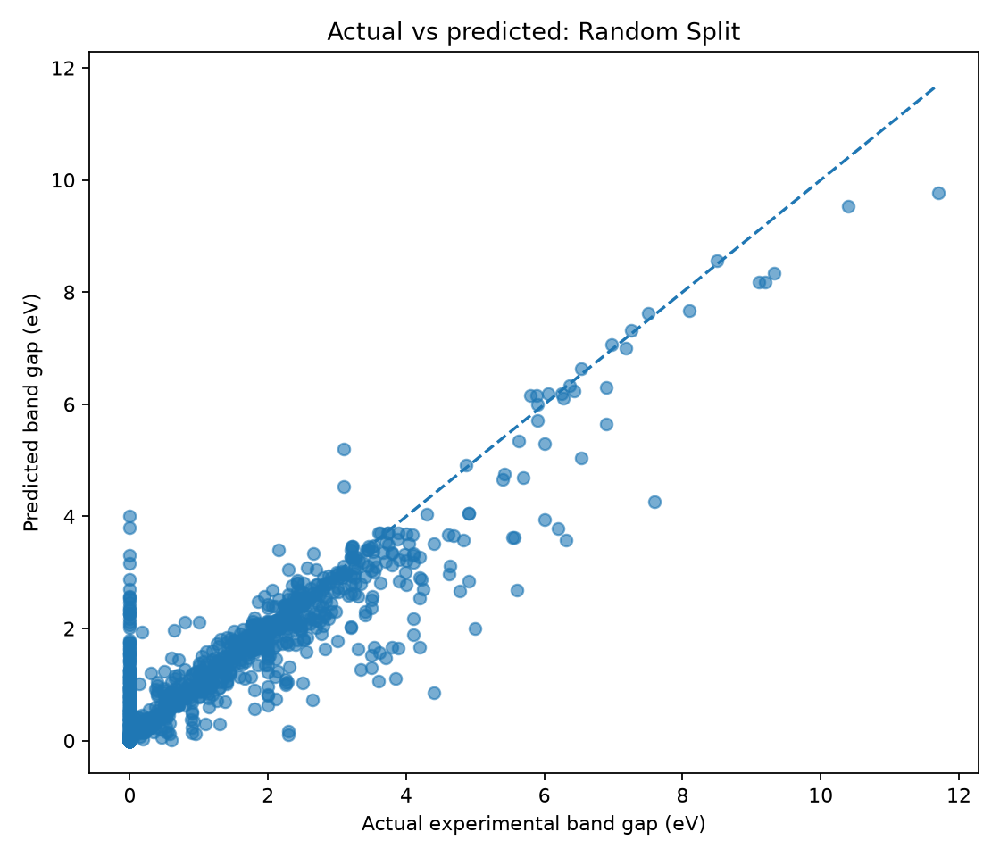
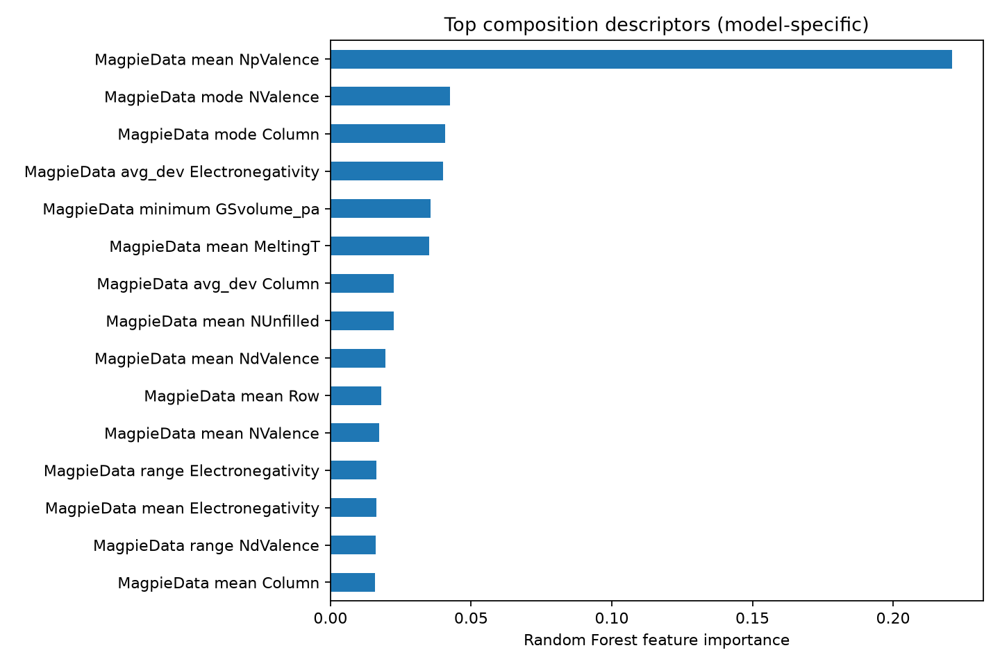

# Experimental Band-Gap Prediction and Model Reliability

**A reproducible materials-ML project using Python and composition-derived features.**

## Research question

How well can machine learning predict experimentally measured band gaps from composition-derived features, and how much does performance change when testing on materials outside the training set?

This is an educational prototype using an existing dataset. It is not a new materials discovery and does not replace experiments or physics-based simulation.

## Dataset

The project uses the `expt_gap` dataset from `matminer`, containing experimental band-gap data.

After cleaning, the workflow retained **6,353 records**, represented by **132 composition-derived features** and **4,920 unique reduced formulae**.

Before public release, check and include the dataset's appropriate citation and license information from the relevant `matminer` documentation.

## Methods

1. Load and inspect the dataset.
2. Clean missing or invalid formulae and target values.
3. Generate Magpie composition descriptors.
4. Compare a mean-prediction baseline with a Random Forest regressor.
5. Evaluate using both a random holdout and a reduced-formula-grouped holdout.
6. Save metrics, predictions and plots to `outputs/`.

## Results

Results from my run (random seed 42):

| Evaluation            | Model         | MAE (eV) | RMSE (eV) | R²       |
|-----------------------|---------------|----------|-----------|----------|
| Random split          | Mean baseline | 1.2207   | 1.5716    | -0.0004  |
| Random split          | Random Forest | 0.3568   | 0.6613    | 0.8229   |
| Formula-grouped split | Mean baseline | 1.1651   | 1.4965    | -0.0006  |
| Formula-grouped split | Random Forest | 0.4458   | 0.8059    | 0.7098   |

The Random Forest performed substantially better than the mean baseline on both splits. Its errors increased on the formula-grouped split, indicating that evaluation design affects the reported performance.

### Random split



### Formula-grouped split


### Feature importance



Feature importance is specific to this trained model. It should not be interpreted as proof that a feature causes a material's band gap.

## Why use two evaluations?

A random split can place chemically similar compositions in both training and test sets. Grouping by reduced formula keeps each formula in only one split, giving a more challenging test of performance on held-out formulae.

This does not guarantee complete chemical novelty or eliminate all dataset bias.

## Scientific limitations

- Composition-only features omit crystal structure, defects, measurement conditions and other potentially important factors.
- Experimental band-gap datasets may combine different measurement methods and sources.
- Feature importance is model-specific, not causal evidence.
- The grouped split does not establish generalisation to every unseen material family.
- Predictions are model estimates, not experimental measurements or new discoveries.

## Project outputs

- `outputs/metrics.json` — evaluation metrics and run details
- `outputs/predictions_random_split.csv` — random-split predictions
- `outputs/predictions_grouped_split.csv` — formula-grouped predictions
- `outputs/random_split_actual_vs_predicted.png` — random-split plot
- `outputs/grouped_split_actual_vs_predicted.png` — grouped-split plot
- `outputs/feature_importance.png` — model feature-importance plot

## Reproduce the project

Python 3.12 worked in my environment.

```bash
python -m venv .venv
source .venv/bin/activate
python -m pip install -r requirements.txt
python src/train_model.py
```

The first run may need internet access to download the dataset. On macOS, activate the environment with `source .venv/bin/activate`.

## Skills demonstrated

Python, Pandas, scikit-learn, matminer, materials data processing, regression, model evaluation, data visualisation and reproducible workflows.